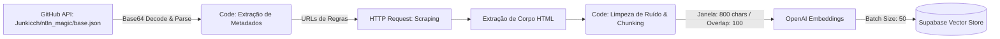
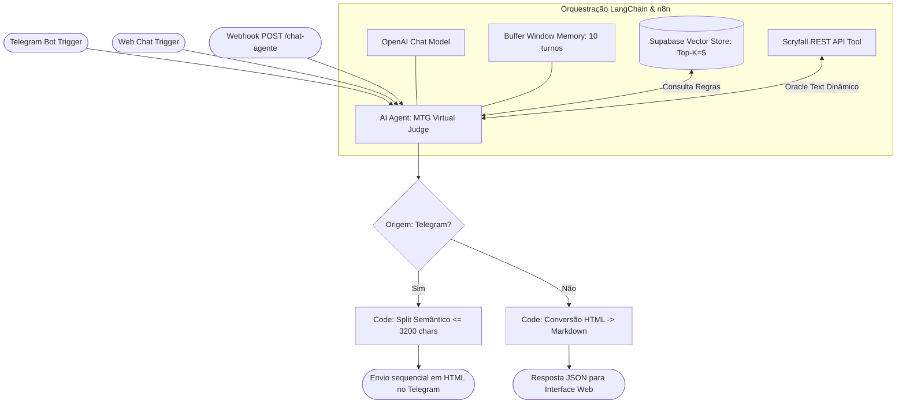

# 🧙‍♂️ MTG Virtual Judge — Agente Autônomo Multicanal com RAG & Tool Calling


-3ECF8E?style=for-the-badge&logo=supabase&logoColor=white)

-F7DF1E?style=for-the-badge&logo=javascript&logoColor=black)

> **Árbitro virtual especializado em Magic: The Gathering**, projetado com uma arquitetura híbrida de **RAG (Retrieval-Augmented Generation)** e **Tool Calling em tempo real** para eliminar alucinações em consultas complexas de regras (*Comprehensive Rules*), camadas, pilha, prioridade e interações entre cartas.

---

## 🎯 Problema de Negócio & Solução de Engenharia

Modelos de linguagem (LLMs) puros frequentemente alucinam ao arbitrar interações de jogos de cartas estratégicos porque:
1. **Conhecimento paramétrico desatualizado ou impreciso:** LLMs confundem textos oficiais de cartas (*Oracle Text*), custos de mana e erratas recentes.
2. **Regras altamente formais:** O livro de regras de *Magic: The Gathering* possui centenas de páginas de lógica estrita (sistema de camadas, ações baseadas em estado e prioridade na pilha).

Para resolver isso, este projeto implementa um **Agente de IA Determinístico e Auditável** orquestrado via **n8n + LangChain**, separando estritamente as fontes de verdade:
* **Fonte de Verdade para Cartas (Tool Calling):** Consumo dinâmico da API REST oficial do **Scryfall** (`fuzzy search`) sempre que uma carta é mencionada.
* **Fonte de Verdade para Regras (Vector RAG):** Recuperação semântica (*Top-K = 5*) sobre documentos oficiais previamente higienizados, fragmentados e indexados no **Supabase Vector Store (pgvector)**.

---

## 🏗️ Arquitetura do Sistema

O projeto é dividido em dois fluxos independentes dentro do workflow: o **Pipeline ETL de Ingestão Vetorial** e o **Pipeline de Inferência Multicanal do Agente**.

### 1. Pipeline ETL de Ingestão e Vetorização (RAG)



* **Extração e Normalização:** Consome o manifesto `base.json` versionado no repositório `Junkicch/n8n_magic` via GitHub API, decodifica o payload em Base64 e mapeia metadados (`titulo`, `url`, `categoria`, `tipo_fonte`).
* **Higienização Customizada em JS:** Remove cabeçalhos, rodapés corporativos, avisos de cookies e links residuais do HTML bruto.
* **Sliding Window Chunking:** Fragmenta os documentos em blocos de **800 caracteres** com **sobreposição (overlap) de 100 caracteres**, preservando o contexto semântico entre parágrafos e injetando cabeçalhos de rastreabilidade (`[Título - Parte X/Y]`) nos metadados de cada chunk.

### 2. Pipeline de Inferência, Orquestração e Roteamento Multicanal



---

## 🛡️ Engenharia de Prompt, Guardrails e Anti-Alucinação

O agente opera sob um `System Prompt` rigoroso com políticas explícitas de segurança e confiabilidade:

* **Isolamento de Escopo (Domain Guardrail):** Rejeita imediatamente qualquer prompt fora do domínio de *Magic: The Gathering* ou tentativas de *Prompt Injection* / *Jailbreak* sem acionar ferramentas externas (economizando tokens e chamadas de API).
* **Proibição de Memória Interna Isolada:** O agente é impedido de deduzir textos de cartas ou números de regras sem antes invocar `consultar_carta_scryfall` e/ou `Supabase Vector Store`.
* **Fallback Seguro contra Alucinação:** Caso a busca vetorial não retorne contexto suficiente para fundamentar a decisão, o modelo é instruído a declarar explicitamente a ausência de base documental em vez de especular.
* **Rastreabilidade de Fontes:** Toda resposta inclui ao final a citação obrigatória da fonte recuperada nos metadados do banco vetorial (`Fonte consultada: <documento>`).
* **Pós-Processamento Inteligente de Mensagens Longas:** Quando uma explicação de pilha ou camadas ultrapassa 3.200 caracteres, o agente insere o marcador interno `<!--SPLIT-->` exclusivamente em quebras semânticas seguras (fora de tags HTML ou raciocínios em andamento). O nó de pós-processamento valida o limite de segurança (máx. 3.800 caracteres por bloco) e dispara mensagens sequenciais no Telegram.

---

## 📂 Estrutura do Repositório

```bash
├── Magic_Judge.json           # Workflow completo exportado do n8n (ETL + Agente)
├── base.json                  # Manifesto de URLs e documentos oficiais de regras para ingestão
├── index.html                 # Interface web conectada ao Webhook (/chat-agente)
└── README.md                  # Documentação técnica da arquitetura
```

---

## 🚀 Como Reproduzir o Projeto

### Pré-requisitos
* Instância do **n8n** (Self-hosted via Docker ou Cloud).
* Projeto no **Supabase** com a extensão `pgvector` habilitada e tabela `documents` configurada.
* Chave de API da **OpenAI** (para LLM e geração de Embeddings).
* Token de Bot do **Telegram** (criado via `@BotFather`).

### Passo a Passo
1. Clone este repositório:
   ```bash
   git clone [https://github.com/Junkicch/n8n_magic.git](https://github.com/Junkicch/n8n_magic.git)
   ```
2. Importe o arquivo do workflow (`Magic_Judge.json`) na sua instância do **n8n**.
3. Configure as credenciais nos respectivos nós:
   * `OpenAI API` (Chat Model e nós de Embeddings).
   * `Supabase API` (URL do projeto e `service_role` / `anon` key).
   * `Telegram API` (Bot Token).
   * `GitHub API` (conectada ao repositório `Junkicch/n8n_magic` para leitura do `base.json`).
4. **Popule a Base Vetorial:** Clique em **Execute Workflow** no gatilho manual superior para rodar o pipeline ETL de scraping, chunking e inserção no Supabase.
5. **Ative o Agente:** Mude a chave do workflow para **Active** para habilitar os gatilhos do Telegram e do endpoint REST `/chat-agente`.

---

## 👥 Autores e Equipe de Desenvolvimento

Projeto desenvolvido em equipe:

* **Lucas Tony Magalhães de Araújo** — [GitHub (@LucasTNM)](https://github.com/LucasTNM) | [LinkedIn](https://www.linkedin.com/in/lucas-tony-6899b6336/)
* **João Caio** — [GitHub (@Junkicch)](https://github.com/Junkicch)
* **Sofia Teixeira** - [Github (@SofiClama)](https://github.com/SofiClama)
